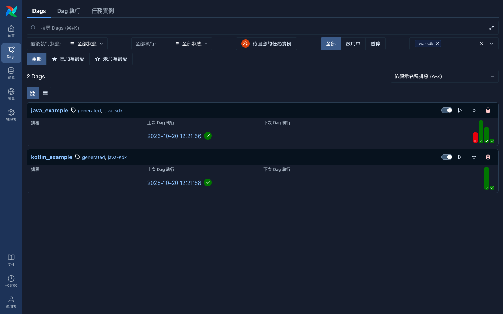
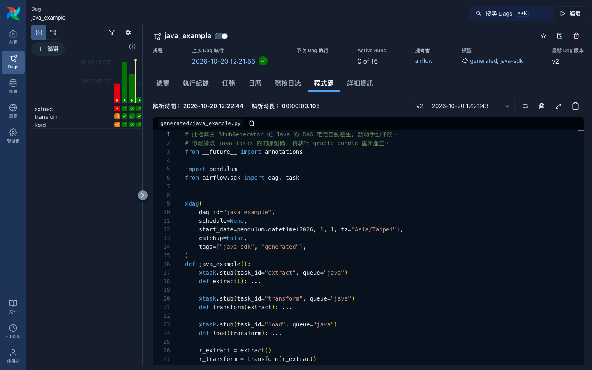
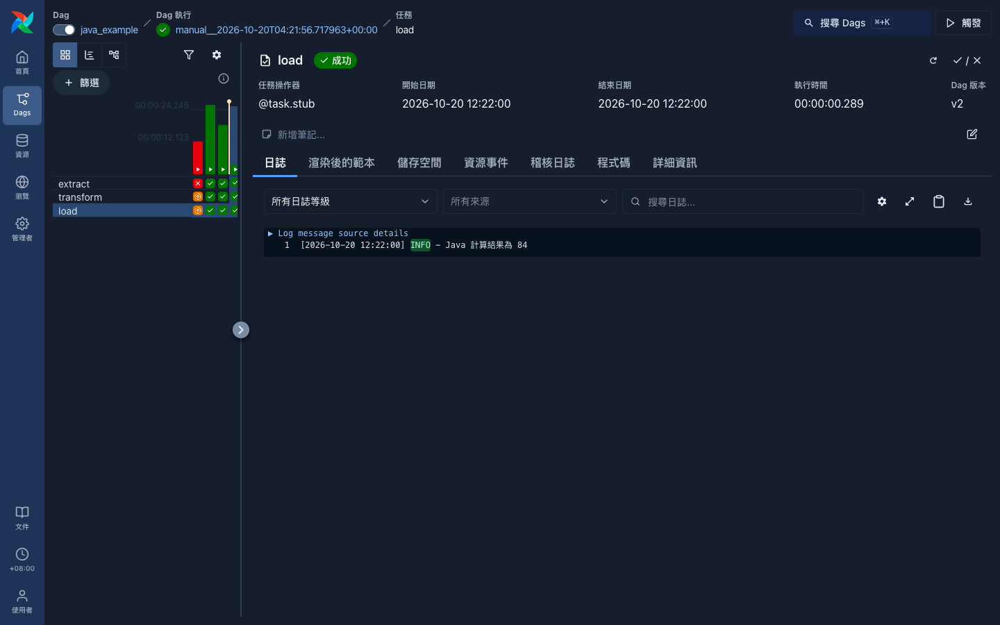
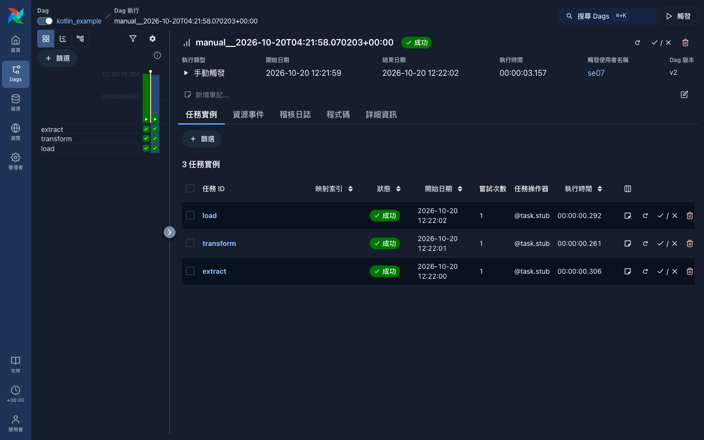
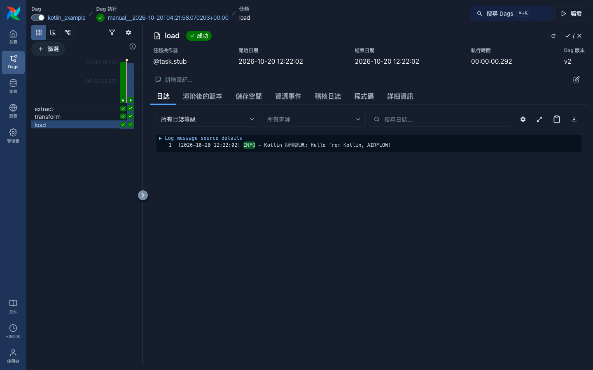

# airflow-java-sdk-demo

使用 Airflow 3.3 與 Java SDK `1.0.0-beta1`, 示範整個工作流都不需要手寫 Python。DAG、task 與依賴關係全部用 Java 或 Kotlin 撰寫, Airflow 需要的 Python stub 由 Java 程式自動產生。



## 為什麼需要產生 Python stub

Airflow 3.3 的 DAG 一定要以 Python 定義, 這是官方文件的限制, task 的實作才可以換成其他語言。而 Java SDK `1.0.0-beta1` 的 `Dag` 物件只記錄 DAG id 與 task, 不含依賴關係與排程, Airflow 也還不會向 JVM 請求解析 DAG。

所以本專案的做法是:

1. 以 Java 或 Kotlin 寫 DAG 與 task, 依賴關係用 `@Builder.XCom` 表示。
2. `StubGenerator` 以反射讀出 DAG、task 與 `@Builder.XCom`, 推得依賴關係, 產生 Python stub 到 `dags/generated/`。
3. Airflow 讀取 stub 得到 DAG 結構, 每個 task 再由 `JavaCoordinator` 啟動 JVM 執行。

使用者全程只需要維護 Java 與 Kotlin 原始碼, `dags/generated/` 不進版控, 每次建置都會重新產生。



## 運作方式

1. Airflow 讀取 `dags/generated/` 的 Python 檔案, 取得 DAG 結構。
2. 標示為 `@task.stub` 且 `queue="java"` 的 task 不會在 Python 內執行, 而是依 `queue_to_coordinator` 設定轉交給 `JavaCoordinator`。
3. `JavaCoordinator` 在 `jars_root` 內找到 bundle JAR, 啟動 JVM 執行對應的 Java 或 Kotlin 方法。
4. task 之間的回傳值透過 XCom 傳遞。

## 專案結構

| 路徑 | 說明 |
| :--- | :--- |
| `java-tasks/src/main/java/com/example/JavaExample.java` | Java 的 DAG 與 task, 包含 `extract`、`transform`、`load` |
| `java-tasks/src/main/kotlin/com/example/KotlinExample.kt` | Kotlin 的 DAG 與 task, 寫法與 Java 相同 |
| `java-tasks/src/main/java/com/example/Main.java` | bundle 進入點, 註冊所有 DAG |
| `java-tasks/src/main/java/com/example/StubGenerator.java` | 由 Java 的 DAG 定義產生 Python stub |
| `java-tasks/build.gradle.kts` | Gradle 建置, `bundle` 結束後會自動執行 `generateStubs` |
| `dags/generated/` | 自動產生的 Python stub, 不進版控 |
| `dags/hello_dag.py` | 純 Python 的通用範例 DAG, 與本示範無關, 僅供對照 |

## 先決條件

- Python 3.14 與 [uv](https://docs.astral.sh/uv/), 只用來安裝與執行 Airflow 本身
- JDK 17 以上
- Gradle

## 執行步驟

### 1. 安裝 Airflow

```bash
uv sync
```

### 2. 建置 bundle 並產生 stub

```bash
cd java-tasks
gradle bundle
```

這一個指令會完成兩件事:

- 產出 `java-tasks/build/bundle/java-tasks-all.jar`。
- 產生 `dags/generated/java_example.py` 與 `dags/generated/kotlin_example.py`。

Kotlin 的 annotation processor 透過 `kapt` 執行。

### 3. 設定 Airflow

`airflow.cfg` 不納入版控。在其中加入以下設定, `jars_root` 請改成實際的絕對路徑:

```ini
[sdk]
coordinators = {"java-jdk17": {"classpath": "airflow.sdk.coordinators.java.JavaCoordinator", "kwargs": {"jars_root": ["/absolute/path/to/airflow-java-sdk-demo/java-tasks/build/bundle"]}}}
queue_to_coordinator = {"java": "java-jdk17"}
```

### 4. 啟動 Airflow

```bash
export AIRFLOW_HOME=$PWD
export PATH=$PWD/.venv/bin:$PATH
airflow standalone
```

- 必須設定 `AIRFLOW_HOME`, 否則 Airflow 會改讀 `~/airflow`, 而不是這個專案的 `airflow.cfg`。
- `standalone` 會呼叫 PATH 上的 `airflow`, 所以也要把 `.venv/bin` 加進 `PATH`。
- UI 位於 `http://localhost:8080`, 帳號為 `admin`, 密碼在 `simple_auth_manager_passwords.json.generated`。

### 5. 觸發 DAG

在 UI 的 Dags 頁面點選 `java_example` 或 `kotlin_example`, 再按右上角的「觸發」。也可以使用指令列:

```bash
airflow dags unpause java_example
airflow dags trigger java_example
```

## 預期結果

三個 task 全部由 JVM 執行, 在 UI 上的任務操作器都顯示為 `@task.stub`。

### `java_example`

`extract` 回傳 42, `transform` 乘以 2, `load` 印出「Java 計算結果為 84」。



### `kotlin_example`

`extract` 回傳 `"airflow"`, `transform` 回傳 `"Hello from Kotlin, AIRFLOW!"`, `load` 印出該訊息。





## 新增自己的 DAG

1. 新增一個類別並加上 `@Builder.Dag`, 方法加上 `@Builder.Task`, 上游的回傳值用 `@Builder.XCom` 接收。
2. 把新 DAG 的 `XxxBuilder.build()` 加進 `Main.getDags()`。
3. 執行 `gradle bundle`, 就會產生對應的 stub。

```java
@Builder.Dag(id = "my_dag")
public class MyDag {
  @Builder.Task(id = "first")
  public String first(Client client) { return "hi"; }

  @Builder.Task(id = "second")
  public String second(Client client, @Builder.XCom(task = "first") String text) { return text + "!"; }
}
```

## 限制

- 依賴關係只能由 `@Builder.XCom` 推得, 沒有回傳值需要傳遞的順序依賴, 目前無法表示。
- 排程固定為 `schedule=None`, 也就是手動觸發。`@Builder.Dag` 的 `to` 屬性在 `1.0.0-beta1` 的註解處理器中沒有被使用。
- 產生器依慣例由 `XxxBuilder` 推回使用者的 `Xxx` 類別, 所以 DAG 類別必須與註解處理器產生的 Builder 在同一個套件。
- Airflow 本身是 Python 應用程式, 所以環境中仍然需要 Python, 只是不需要撰寫。
- Java SDK 目前為 `1.0.0-beta1`, API 之後可能會變動。若官方之後讓 Airflow 直接解析 Java 的 DAG, 就可以移除這個產生器。

## 疑難排解

| 現象 | 原因與處理 |
| :--- | :--- |
| UI 看不到 DAG | 先執行 `gradle bundle` 產生 stub, 並確認 `dags/generated/` 有檔案。 |
| `airflow dags test` 出現 `@task.stub should not be executed directly` | `dags test` 在同一個行程內執行 task, 不會經過 coordinator, stub 無法用它驗證。請改用 `airflow standalone` 並觸發 DAG。 |
| `airflow` 指令提示 `Database migration required` | 先執行 `airflow db migrate`。 |
| `airflow standalone` 的子行程啟動失敗 | `airflow` 不在 `PATH`, 請先 `export PATH=$PWD/.venv/bin:$PATH`。 |
| 8080 Port 已被占用 | 先前的 Airflow 行程還在執行, 請先停止, 修改過設定後也需要重啟才會生效。 |
| task 找不到 JAR 或 `Main-Class` | 確認已執行 `gradle bundle`, 且 `jars_root` 是正確的絕對路徑。 |
| 改了 Java 或 Kotlin 程式碼後沒有生效 | 重新執行 `gradle bundle`。每個 task 都會啟動新的 JVM, 不需要重啟 Airflow, 但 DAG 結構變動後 dag-processor 需要數十秒才會重新解析 stub。 |

官方文件請參考 [Java SDK](https://airflow.apache.org/docs/apache-airflow/stable/authoring-and-scheduling/language-sdks/java.html)。
